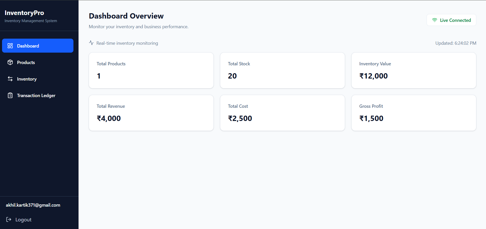
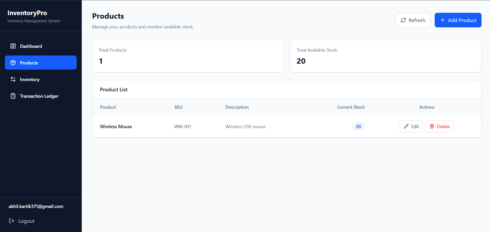
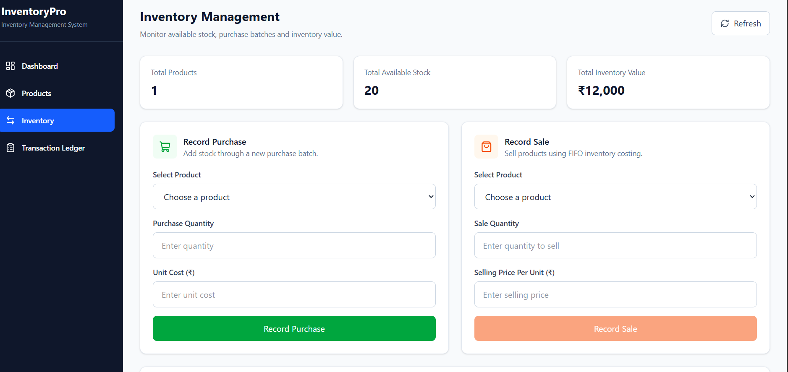
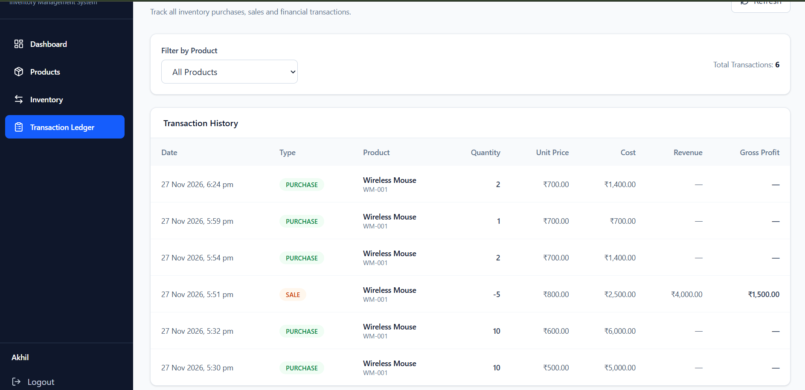
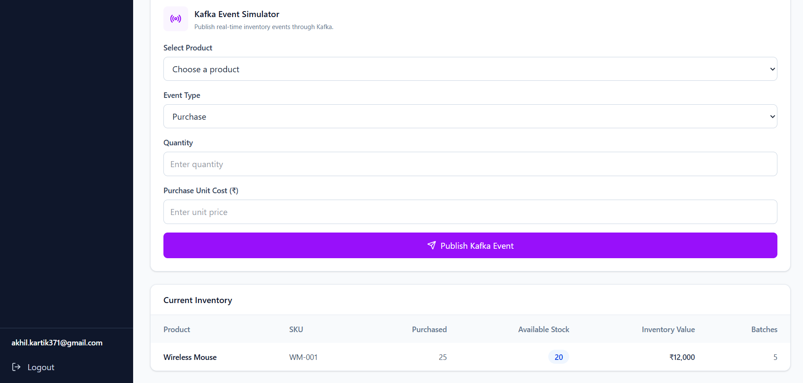

# InventoryPro – Real-Time Inventory Management System

A full-stack inventory management system built with **FIFO (First-In, First-Out) inventory costing**, real-time event ingestion using Kafka, and a live dashboard powered by Server-Sent Events (SSE).

## 🚀 Live Application

- **Frontend:** https://frontend-topaz-tau-l5q1f48ean.vercel.app
- **Sign In:** https://frontend-topaz-tau-l5q1f48ean.vercel.app/login
- **Backend API:** https://inventory-management-system-9fjz.onrender.com
- **GitHub Repository:** https://github.com/AKHIL1633/inventory-management-system

## 🔑 Demo Login Credentials

Use the following registered account to sign in to the deployed application.

| Field | Details |
|---|---|
| Login URL | https://frontend-topaz-tau-l5q1f48ean.vercel.app/login |
| Email | `akhil.kartik371@gmail.com` |
| Password | Shared privately with the reviewers |

After signing in, reviewers can explore product management, inventory operations, FIFO transaction processing, Kafka event simulation, and the real-time dashboard.

## 📸 Application Screenshots

### 1. Dashboard Overview

Monitor inventory performance through a real-time dashboard displaying total products, available stock, inventory value, revenue, cost, and gross profit.



### 2. Product Management

Create, update, delete, and manage products with unique SKUs and stock information.



### 3. Inventory Management

Record purchases and sales while maintaining inventory batches and applying FIFO-based inventory costing.



### 4. Transaction Ledger

View purchase and sales history, including quantity, unit price, cost, revenue, and gross profit.

The ledger demonstrates FIFO cost allocation during sales.



### 5. Kafka Event Simulator

Publish purchase and sale events through Kafka and monitor the resulting inventory changes.



## ✨ Key Features

### Inventory Management
- Create, update, and delete products.
- Maintain product SKUs and descriptions.
- Record inventory purchases and sales.
- Track available stock and inventory value.
- Maintain individual purchase batches.

### FIFO Inventory Costing
- Implements First-In, First-Out inventory valuation.
- Consumes the oldest available purchase batches first.
- Calculates Cost of Goods Sold (COGS).
- Calculates sales revenue and gross profit.
- Maintains transaction-level cost allocation.

### Real-Time Event Processing
- Integrates Kafka for inventory event ingestion.
- Supports purchase and sale events.
- Processes incoming events asynchronously.
- Uses PostgreSQL for persistent inventory storage.
- Implements event deduplication and idempotent processing.
- Uses an outbox pattern for reliable publication of REST-generated inventory events.

### Live Dashboard
- Uses Server-Sent Events (SSE) for real-time notifications.
- Automatically refreshes dashboard metrics when inventory events are processed.
- Includes automatic SSE reconnection.
- Displays live connection status.

### Authentication
- User registration and login.
- JWT-based authentication.
- Password hashing using bcrypt.
- Protected API endpoints.

## 🏗️ System Architecture

```text
             React Frontend
                   |
                   | REST API
                   |
             Node.js / Express
                   |
          +--------+---------+
          |                  |
      PostgreSQL         Outbox
          |                  |
          |              Kafka Producer
          |                  |
          |                  v
          |             Kafka Topic
          |                  |
          |                  v
          |             Kafka Consumer
          |                  |
          +------------------+
                   |
             Inventory Events
                   |
             FIFO Processing
                   |
             PostgreSQL
                   |
             Dashboard Events
                   |
                  SSE
                   |
                   v
             React Dashboard
```

## 🛠️ Technology Stack

| Category | Technologies |
|---|---|
| Frontend | React.js, Vite, Tailwind CSS |
| Backend | Node.js, Express.js |
| Database | PostgreSQL |
| Message Broker | Apache Kafka (Redpanda Cloud) |
| Real-Time Communication | Server-Sent Events (SSE) |
| Authentication | JWT, bcrypt |
| Deployment | Vercel, Render |
| Version Control | Git, GitHub |

## 📂 Project Structure

```text
inventory-management-system/
│
├── backend/
│   ├── src/
│   │   ├── config/
│   │   ├── controllers/
│   │   ├── middleware/
│   │   ├── routes/
│   │   ├── services/
│   │   └── kafka/
│   │
│   ├── patches/
│   ├── package.json
│   └── .env.example
│
├── frontend/
│   ├── src/
│   │   ├── api/
│   │   ├── components/
│   │   ├── context/
│   │   ├── pages/
│   │   └── App.jsx
│   │
│   ├── package.json
│   └── vercel.json
│
├── producer/
│
├── screenshots/
│   ├── dashboard.png
│   ├── products.png
│   ├── inventory.png
│   ├── transaction-ledger.png
│   └── kafka-simulator.png
│
├── docker-compose.yml
└── README.md
```

## ⚙️ Local Setup and Installation

### Prerequisites

- Node.js and npm
- PostgreSQL
- Git
- A Kafka-compatible broker (such as Redpanda)

### 1. Clone the Repository

```bash
git clone https://github.com/AKHIL1633/inventory-management-system.git

cd inventory-management-system
```

### 2. Configure Backend

```bash
cd backend
npm install
```

Create a `.env` file using the provided `.env.example` as a reference.

Configure the required database, authentication, Kafka, and application environment variables.

### 3. Configure Database

Create a PostgreSQL database and configure its connection details in the backend environment.

Run the SQL migrations provided in the project in their numbered order.

### 4. Start the Backend

```bash
npm run dev
```

### 5. Start the Frontend

Open another terminal:

```bash
cd frontend
npm install
npm run dev
```

Open the local frontend URL displayed by Vite in your browser.

## 📊 FIFO Inventory Costing Example

Consider the following purchase transactions:

| Purchase Batch | Quantity | Unit Cost | Total Cost |
|---|---:|---:|---:|
| Batch 1 | 10 | ₹500 | ₹5,000 |
| Batch 2 | 10 | ₹600 | ₹6,000 |

Total inventory: 20 units.

Now sell 5 units at ₹800 per unit.

Under FIFO, the oldest batch is consumed first.

**Cost calculation:**

- 5 units × ₹500 = ₹2,500 COGS
- Revenue = 5 × ₹800